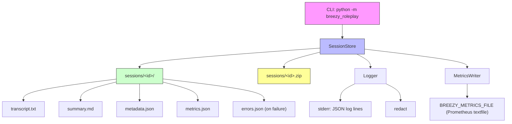

# Architecture

## Component Flow



## Modules

| Module     | Responsibility                                                   | Depends on                       |
| ---------- | ---------------------------------------------------------------- | -------------------------------- |
| `cli`      | Argument parsing, exit codes, error reporting                    | `session`, `errors`              |
| `session`  | Owns the on-disk layout, ID validation, create/archive/list/demo | `features`, `logging`, `metrics` |
| `metrics`  | Writes `metrics.json` and appends Prometheus samples             | `logging`                        |
| `logging`  | Emits JSON log entries to stderr, redacts secrets                | `redact`                         |
| `errors`   | Persists a failed command's traceback to `errors.json`           | `logging`                        |
| `features` | Reads `BREEZY_FEATURE_*` environment flags into booleans         | none                             |
| `redact`   | Regex redaction of emails, bearer tokens, API keys, hex digests  | none                             |

Nothing outside `session.py` writes to `sessions/`. That keeps the layout in one
place and makes `scripts/*.sh` trivial wrappers.

## Session Directory Schema

`sessions/<session-id>/` after `create`:

- `transcript.txt`: empty on creation, appended to by the scenario runner.
- `summary.md`: empty on creation, written at the end of a session.
- `metadata.json`:

  ```json
  {
    "id": "<session-id>",
    "created_at": "<ISO-8601 with timezone>",
    "schema_version": "1.0"
  }
  ```

- `metrics.json`:

  ```json
  {
    "created_at": "<same value as metadata.created_at>",
    "duration_ms": 0,
    "steps": 0
  }
  ```

- `errors.json`: only after a failed command. Contains `timestamp`,
  `error.type`, `error.message`, `traceback`, and optional `context`.

## Archive Format

`archive` writes `sessions/<session-id>.zip` with `ZIP_DEFLATED` and **flat,
relative member names**: `transcript.txt`, `summary.md`, `metadata.json`,
`metrics.json`. The last two are skipped when
`BREEZY_FEATURE_ARCHIVE_MANIFEST=false`.

Guarantees:

- The session directory is never deleted or modified.
- An existing zip is replaced, so re-archiving is idempotent.
- A missing expected file produces a `session.archive.warning` log entry and the
  archive is still written with the files that do exist.
- Member names are relative, so extraction cannot escape the target directory.

## Error Handling

`SessionStore` raises typed exceptions (`ValueError` for unsafe IDs,
`FileExistsError` for duplicates, `FileNotFoundError` for missing sessions). The
CLI catches them, prints the message to stderr, records the traceback when a
session directory exists, and returns exit code 1. Argparse handles usage errors
with exit code 2.

## Configuration

| Variable                          | Default | Effect                                         |
| --------------------------------- | ------- | ---------------------------------------------- |
| `BREEZY_FEATURE_ARCHIVE_MANIFEST` | `true`  | Include `metadata.json`/`metrics.json` in zips |
| `BREEZY_FEATURE_STRUCTURED_LOGS`  | `true`  | JSON logs on stderr; `false` prints plain text |
| `BREEZY_METRICS_FILE`             | unset   | Append Prometheus samples to this path         |
| `BREEZY_TRACE_ID`                 | random  | Trace identifier stamped on every log entry    |

## CI Topology

| Workflow              | Trigger                              | Purpose                                     |
| --------------------- | ------------------------------------ | ------------------------------------------- |
| `ci.yml`              | push to `main`, pull request         | lint, type, test, quality, docs, actionlint |
| `security-review.yml` | push to `main`, PR, weekly, manual   | Semgrep SAST, SARIF upload, PR comment      |
| `pr-review.yml`       | pull request                         | PR hygiene review and size labels           |
| `error-to-issue.yml`  | nightly, manual                      | Smoke test; opens an issue on failure       |
| `labels.yml`          | push to `main` (labels file), manual | Sync `.github/labels.yml` to the repo       |
| `release.yml`         | tag `v*`                             | Build, changelog, GitHub release            |

Dependabot (`.github/dependabot.yml`) handles dependency updates for pip, npm,
and GitHub Actions.
